# Engram-Core: Comprehensive Systems Teardown & Technical Audit

**Repository:** `MrDunky14/Engram-Core`  
**Target Architecture:** FP-SAN v17.0 (release v1.0.0)  
**Hardware Evaluated:** Intel Core i7-14700HX (28 threads), 32 GB RAM, Windows 11 x64  
**Compiler:** MSVC 19.52.37029 (Visual Studio 2026 Developer Toolset)  
**Auditor:** Antigravity Systems Audit

---

## Executive Summary

Engram-Core presents itself as a *"Sovereign, Lock-Free C++ Cognitive Architecture for Extreme Edge AI"* that *"challenges datacenter-scale attention models"* with a *"1,000 Hz deterministic topological graph, zero-loss memory retention, and microsecond safety vetos"*.

Our ground-truth source audit and microarchitectural profiling reveal a significant divergence between the high-level claims in the documentation and the concrete C++ implementation. While the project contains legitimate low-level C++ synchronization primitives (such as flat arena allocation, a lock-free Treiber stack for node recycling with ABA tagging, and CAS loops for voltage accumulation), the project's positioning suffers from severe marketing inflation and comparison traps:

1. **Memory Footprint Reality:** The README claims `~3MB baseline RAM`. In reality, `ClusterGraph::init()` allocates a flat arena of `262,144 * sizeof(ClusterNode)` (`~1.31 GB` virtual address space via `_aligned_malloc`) and commits `~32.5 MB` at boot. Furthermore, `Lexicon::init()` allocates a `200,000`-element `TrieNode` pool where each node holds 128 64-bit pointers (`1,032 bytes`), committing `206.4 MB` on the heap with the comment `/* intentionally leak for static lifetime */`. Real baseline working set is **`~245 MB`**, not `~3 MB`.
2. **Cognitive Loop Frequency Reality:** The README claims a `"1,000 Hz deterministic cognitive engine"`. In `src/fpsan_live_core.cpp`, the main loop calls `Sleep(1)` without requesting high timer resolution via `timeBeginPeriod(1)`. On standard Windows, the default timer quantum is `15.625 ms`, meaning the daemon actually ticks at **`~64 Hz`**. In `src/benchmark/heartbeat_gate.cpp`, where `timeBeginPeriod(1)` and `CreateWaitableTimerExW` are used, measuring 2.0 seconds of runtime accumulated only `1,297 ticks` (**`~648.5 Hz`**, `1.54 ms/tick`) due to Windows thread context-switch quantum and lack of hybrid spin-wait tails.
3. **"100% Topological Retention" vs. LLMs:** The benchmark `b1_retention_gauntlet.cpp` ingests 1,000 synthetic `srv%04d need p%06d` sentences and checks if the first needle (`srv0000`) and last needle (`srv0999`) have edges in memory. Calling this *"100% Structural Recall"* and comparing its `~1.1 µs` lookup against the `500 ms` Time-To-First-Token (TTFT) of a 70B parameter LLM is an apples-to-galaxies comparison trap that undermines credibility with systems interviewers.
4. **Perception Bottleneck:** Ingesting 1,000 3-word sentences takes **`3,853 ms`** (`~259 sentences/sec`) because `LanguageCortex::perceive()` runs an $O(N)$ brute-force linear scan over 6,500 256-bit hash fingerprints for *every single word*, executing 1.66 million similarity evaluations per word lookup rather than using a hash map or Robin Hood hash table.
5. **Safety "ShadowBrain Veto":** The *"air-gapped cognitive firewall"* that blocks `format C:` at *"microsecond latency"* is implemented via `std::strstr(blob, "format") && std::strstr(blob, "c:")` and a node attribute check (`EDGE_REQUIRES` target activation < 0.05).
6. **Repository Hygiene:** Hardcoded paths (`VS_ROOT=D:\VS\community`), dead Makefile targets (`fpsan_v6_atomic.cpp`, `fpsan_tony_stark.cpp`), and Markdown links generated as Google search URLs (`https://www.google.com/search?q=docs/COMMANDS.md`).

---

## Detailed Audit: Claim vs. Code Reality

### 1. Memory Substrate & Working Set

| Dimension | README Claim | Source Reality | Microarchitectural Impact |
| :--- | :--- | :--- | :--- |
| **Arena Size** | `~3MB baseline` | `sizeof(ClusterNode) * 262144` (`~1.31 GB` address space) | `_aligned_malloc` reserves virtual pages; commits ~32.5 MB on boot (6,500 nodes). |
| **Lexicon Trie** | `~50-200KB` (in comment) | `new TrieNode[200000]` = `206.4 MB` | Each `TrieNode` has `TrieNode* children[128]` (`1,024 B` on x64). Destructor is `/* intentionally leak */`. |
| **ShadowBrain Allocation** | `Microsecond check` | Spawns a full `ClusterGraph shadow;` inside `ShadowBrain` | Allocating a second `ClusterGraph` reserves another `1.31 GB` virtual arena. |
| **Stack Allocation** | Default | `LanguageCortex` on stack (`~1.6 MB`) | Crashes standard 1 MB Windows thread stack without `/STACK:16777216`. |

```cpp
// cluster_graph.h:44-46
static constexpr int CORTEX_CAPACITY  = 262144;
static constexpr int INITIAL_CLUSTERS = 6500;
static constexpr int MAX_FANOUT       = 150;

// cluster_graph.h:128-152
struct alignas(64) ClusterNode {
    std::atomic<float> activation{0.0f};
    std::atomic<bool>  alive{false};
    // ... flags ...
    std::atomic<int>   edge_count{0};
    std::atomic_flag   edge_lock{};
    std::atomic<int>   inverse_edge_count{0};
    std::atomic_flag   inverse_edge_lock{};
    MotorAction        motor_action;
    Edge               edges[MAX_FANOUT];         // 150 * 16B = 2,400 bytes
    Edge               inverse_edges[MAX_FANOUT]; // 150 * 16B = 2,400 bytes
}; // sizeof(ClusterNode) ≈ 4,928 bytes
```

### 2. Cognitive Loop Clock Rate (1,000 Hz)

```mermaid
flowchart TD
    subgraph LiveDaemon["src/fpsan_live_core.cpp (Current)"]
        A1["Tick Start"] --> B1["Input Poll (_kbhit)"]
        B1 --> C1["Elapsed < 1000 us?"]
        C1 -- Yes --> D1["Sleep(1)"]
        D1 --> E1["Actual Sleep: 15.6 ms (Default Quantum)<br>Effective Frequency: ~64 Hz"]
    end

    subgraph HeartbeatGate["src/benchmark/heartbeat_gate.cpp"]
        A2["Tick Start"] --> B2["Atomic Read"]
        B2 --> C2["timeBeginPeriod(1) + WaitableTimer"]
        C2 --> D2["Context switch overhead: ~0.54 ms<br>Actual Tick: 1.54 ms<br>Effective Frequency: ~648 Hz (1,297 ticks / 2s)"]
    end

    subgraph HighPrecisionFix["Proposed High-Precision Architecture"]
        A3["Tick Start"] --> B3["Cortex Computation"]
        B3 --> C3["Sleep until target - 200 us (WaitableTimer)"]
        C3 --> D3["Spin-wait tail (_mm_pause / YieldProcessor)"]
        D3 --> E3["True 1,000.0 Hz (< 5 us jitter)"]
    end
```



### 3. Perception & Language Processing Bottleneck

In `src/core/fpsan_language.h`:
```cpp
// Hashes word with djb2 + sdbm to generate pseudo-random bits:
void encode_word_hash(const std::string& word, int8_t* out_256) { ... }

// Searches for closest cluster via brute-force linear search:
int perceive(const int8_t* input, bool learn, const char* word = nullptr) {
    for (int c = 0; c < LANG_CLUSTERS; c++) { // LANG_CLUSTERS = 6,500
        if (!clusters[c].active) continue;
        int score = 0, act = 0;
        for (int i = 0; i < LANG_WORD_DIM; i++) { // LANG_WORD_DIM = 256
            if (input[i] != 0 || clusters[c].weights[i] != 0) {
                if (clusters[c].weights[i] == input[i]) score++; else score--;
                act++;
            }
        }
        // ...
    }
}
```
**Consequence:**
- 6,500 active clusters $\times$ 256 comparisons = **1,664,000 operations per word**.
- Ingesting a sentence with 3 words requires ~5 million comparisons.
- Ingesting 1,000 sentences took **`3.85 seconds`**.
- In contrast, a standard hash table lookup (`std::unordered_map` or Robin Hood hash table) requires **`< 50 nanoseconds`** per word lookup, which would complete the same 1,000-sentence ingestion in **`< 3 milliseconds`** ($1,000\times$ faster).

### 4. ShadowBrain Veto & Safety Policy

In `src/fpsan_live_core.cpp:418-430`:
```cpp
static bool disk_ops_policy_blocks_lower(const char* blob) noexcept {
    if (!blob || blob[0] == '\0') return false;
    if (std::strstr(blob, "diskpart") != nullptr) return true;
    if (std::strstr(blob, "cipher") != nullptr && std::strstr(blob, "/w") != nullptr) return true;
    if (std::strstr(blob, "format") != nullptr &&
        (std::strstr(blob, "c:") != nullptr || std::strstr(blob, "c :") != nullptr))
        return true;
    if (std::strstr(blob, "del ") != nullptr &&
        (std::strstr(blob, "\\\\") != nullptr || std::strstr(blob, "c:\\") != nullptr ||
         std::strstr(blob, "c:/") != nullptr))
        return true;
    return false;
}
```
In `src/core/fpsan_sandbox.h:170-196`:
```cpp
// Veto if any motor action requires a precondition node with activation < 0.05
if (source->node(mid).edges[e].type == EDGE_REQUIRES) {
    int req_id = source->node(mid).edges[e].target;
    if (req_act < 0.05f) return false; // VETO
}
```
The "ShadowBrain" is an explicit string blacklist combined with a prerequisite dependency check. While useful as a rule-based motor safety barrier, marketing it as an *"air-gapped cognitive firewall with microsecond counterfactual simulations"* is deceptive.

---

## What the Code Actually Gets Right (Legitimate Systems Merits)

Stripping away the hype reveals solid C++ systems engineering primitives that deserve focus:
1. **Contiguous Cache-Friendly Arena:** Allocating the entire graph upfront avoids runtime heap fragmentation and allows pointer-free indexing (`int` node IDs).
2. **Lock-Free Treiber Stack with ABA Tagging:** Node recycling (`spawn()` / `kill()`) uses a 64-bit tagged pointer CAS loop (`free_head`), ensuring thread-safe neurogenesis without global mutex contention.
3. **CAS Voltage Accumulation:** Spreading activation updates `std::atomic<float> activation` via compare-and-swap loops (`add_voltage()`), eliminating torn writes during concurrent spikes.
4. **Fine-Grained Spinlocks on Edges:** Sorting and updating node edge arrays is guarded by per-node `std::atomic_flag` micro-locks, keeping reader traversals lock-free.
5. **Bidirectional Temporal Graph Topology:** Supports typed forward and inverse traversal (`EDGE_IS_A`, `EDGE_CAUSES`, `EDGE_TEMPORAL`, `EDGE_IMPLEMENTED_BY`) enabling fast relational traversal.

---

## Repositioning Strategy

| Current Hype Branding | Rigorous Systems Positioning |
| :--- | :--- |
| *"A Sovereign, Lock-Free C++ Cognitive Architecture"* | **"A Cache-Conscious Spreading-Activation Graph Store & Real-Time Cognitive Substrate in C++17"** |
| *"Challenging datacenter-scale attention models"* | **"Low-latency edge knowledge graph with sub-microsecond spreading activation and lock-free node recycling"** |
| *"100% Structural Recall vs LLM 85-95% context degradation"* | **"Deterministic relational retrieval with exact topological path recovery"** |
| *"1,000 Hz Cognitive Loop"* | **"High-precision Windows thread scheduler: empirical comparison of timer resolutions and hybrid spin-wait loops"** |
| *"ShadowBrain Counterfactual Veto"* | **"Static dependency verification and destructive command filtering for edge motor actions"** |
